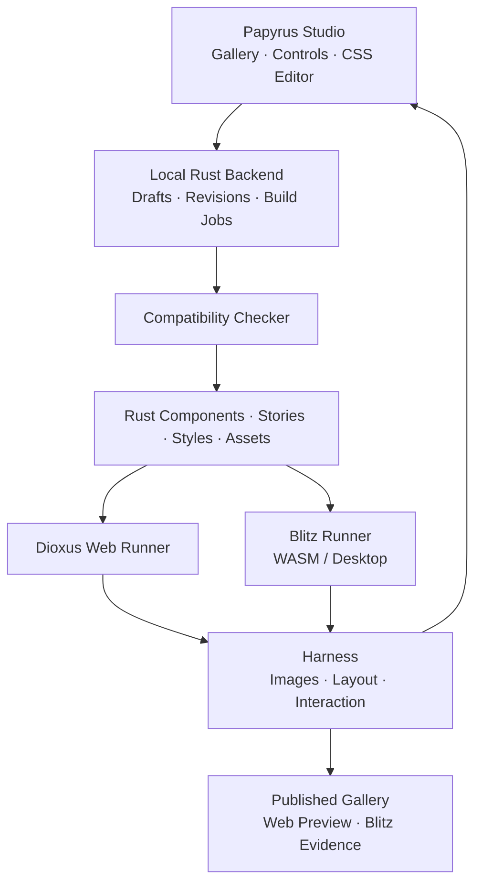

**Papyrus should help teams design, check and publish Rust components that share stylesheets across Web and Blitz. It should provide a Storybook-style component viewer and one workflow for editing, checking, building or reloading, and previewing.**

Its main value is **bringing Web designs into Dioxus Native with evidence that appearance and behavior work on a specified renderer**. Developers should find problems before assembling a full Desktop application.

This proposal uses **Web CSS** for CSS rendered by a browser and **Blitz CSS** for CSS rendered by Blitz. These names do not describe new CSS languages. The design below is a proposal. A prototype must prove the technical paths before we choose a lasting architecture.

**1. The problem Papyrus should solve**

Web components are convenient to design. Moving them to another renderer brings a separate question: valid CSS syntax does not prove that every feature works or looks the same.

At the time of the original proposal, Blitz's status page listed Grid support but no subgrid support. Features such as `backdrop-filter` depended on the chosen rendering backend. A claim of “Blitz support” therefore needs a version and backend. See [Blitz CSS support](https://blitz.is/status/css).

There are four problems to address:

- **Stylesheet compatibility:** declarations, values, selectors or rules may exceed the other target's support.
- **Rendering differences:** text may wrap differently, sizes may change, or content may be clipped.
- **Interaction differences:** a control may look right while focus, keyboard or input behaves differently.
- **A scattered workflow:** developers edit CSS, open Web and Native previews, then check and record the results by hand.

Papyrus should connect these tasks around one shared set of components and stories.

**2. What users should gain**

| User | Work in Papyrus | Benefit |
|---|---|---|
| Designer | Import HTML/CSS, adjust colors, spacing and fonts, and view both renderers | See constraints while designing |
| Rust developer | Connect stories to real Dioxus components | Develop and check components outside the main application |
| Design System team | Manage themes, tokens, variants and states | Maintain components with clear support boundaries |
| QA | Run the same stories and interactions on both targets | Get repeatable, traceable results |
| Online viewer | Open a gallery, try Web components, and inspect Blitz results | Evaluate components without installing Rust |
| Blitz/Dioxus maintainer | Receive small test cases from observed problems | Reproduce and investigate renderer regressions |

The main outputs should be **components and stylesheets, an online gallery, and a support report**, all tied to the same source revision.

**3. The main user experience**

The Papyrus workspace should connect these areas:

| Area | Purpose |
|---|---|
| Component browser | Choose a component, variant and story |
| Preview | Show Web and Blitz side by side with a viewport size and theme |
| Controls | Change props and sample data |
| Style editor | Edit CSS and design tokens |
| Diagnostics | Show problems, source locations and affected targets |
| Comparison | Show overlays, image differences and test results |
| Build status | Show the revision loaded by each preview and its build status |

For example:

1. Open a Card story.
2. Import a stylesheet designed on the Web.
3. The Web preview shows the original design.
4. Papyrus reports a declaration outside the Blitz target's support boundary.
5. The user adjusts the design or adds an explicit style for that target.
6. Papyrus shows a diff before applying the change.
7. Both previews load the new stylesheet revision.
8. Run checks and save the results with that revision.

Keep **experimental previews** and **verified support** distinct. Users may try styles that have not passed checks. Papyrus should label them as supported on both targets only when the evidence is complete.

**4. Define the boundary with a Compatibility Profile**

A Compatibility Profile is the shared record of what a particular target setup supports.

Each profile should record:

- Dioxus and Blitz versions, including Git commits when used.
- The Blitz rendering backend.
- Browser and version used for checks.
- OS, scale factor and fonts.
- CSS, HTML and interaction boundaries.
- Evidence from documentation or test cases.
- Known exceptions and limits.

Each capability needs a clear status:

| Status | Meaning |
|---|---|
| Supported | Passed under the recorded conditions and versions |
| Conditional | Passed with a particular backend or condition |
| Unsupported | Not supported by this target |
| Unknown | There is not enough evidence |
| Regression | Passed before, but failed after a version or implementation change |

**Unknown must not count as Supported.**

Check values as well as property names. Allowing `transform` does not mean allowing both 2D and 3D transforms. Checking `var()` also requires checking the substituted value.

Two stylesheet arrangements are proposed:

- **Shared:** one stylesheet inside the verified boundary of both targets.
- **Shared with target overrides:** one shared base plus explicit Web or Blitz rules.

The second arrangement helps preserve a design when some features cannot yet be shared. Papyrus should make the cost of those differences visible, instead of letting two independent stylesheets drift apart.

**5. The harness needs three layers of checks**

**Layer one — check the source and the CSS actually used**

Use a CSS parser to read stylesheet structure, rather than regex matching. Check declarations, values, selectors, pseudo-classes, pseudo-elements and at-rules against the profile.

Include stylesheets, `@import`, inline styles and generated CSS from tools such as Tailwind. Check the final output again after transformation.

[Lightning CSS](https://lightningcss.dev/) is worth testing because its parser, transformer and bundler are written in Rust. Its browser targets are not automatically a Blitz capability database. Papyrus still needs its own rules.

A source checker may not fully analyze styles created dynamically in Rust. Report what could not be checked, and inspect values actually used in stories. Running stories does not prove coverage of every program branch.

Each diagnostic should include:

- File, line and location.
- The problematic expression or declaration.
- The affected target/profile.
- Reason and evidence source.
- The story where the problem appeared, if applicable.
- A suggested adjustment, stating whether it preserves the original meaning.

**Layer two — check layout and images**

Run the same story with the same props, theme, assets, fonts and available space. Capture images and any layout data the runner can access.

Use two types of comparison:

| Comparison | Purpose |
|---|---|
| New Web against its Web baseline; new Blitz against its Blitz baseline | Detect regressions within each renderer |
| Web against Blitz at the same revision | Detect differences between renderers |

Some rendering differences are acceptable. Do not fail on every changed pixel, especially in font rendering. Check important conditions instead: content is not clipped, sizes stay within agreed limits, and important elements do not overlap.

Control animation, time and random data before capture. Review baseline changes so that updating reference images cannot hide a regression.

Web checks can use [Playwright visual comparisons](https://playwright.dev/docs/test-snapshots). Blitz capture and layout access must be proved with the versions chosen for the prototype.

**Layer three — check interaction and accessibility**

Test the same actions on real components:

- Tab into and out of a control.
- Press Enter or Space.
- Type and edit text.
- Change a value and check state.
- Open or close a dialog and check focus.
- Check disabled and error states.

Setting state so a component looks clicked is not a test of real input delivery. Reports must distinguish the two.

Include Thai wrapping, text selection and input through an IME from the start. The original proposal noted limits in Blitz's composition and clipboard event support. See [Blitz event support](https://blitz.is/status/events).

**6. Stories must use real components**

Each story should contain:

| Information | Example |
|---|---|
| Component and variant | Button / Primary |
| Props | Label, size, disabled |
| State | Default, focus, loading, error |
| Environment | Theme, viewport, font |
| Actions | Click, key press, typing |
| Assertions | Callback fired, content does not overflow |
| Target results | Web, Blitz WASM, Blitz Desktop |
| Revision | Source, stylesheet and profile used |

Start with explicit registration of stories and controls. This is easier to inspect than building a macro to discover and infer every kind of prop in the first version.

The story factory should live in Rust and be called by both Web and Dioxus Native runners. Controls should exchange only declared prop data, rather than attempting to serialize Rust closures or arbitrary Rust values.

**7. Import Web CSS and adapt it for Blitz**

Separate three import cases:

| Imported material | Papyrus's role |
|---|---|
| CSS and assets | Check compatibility, organize dependencies, and preview both renderers |
| HTML + CSS | Create a visual reference and help convert markup to RSX |
| A component tied to a JavaScript framework | Separate markup/style from behavior and identify work to rewrite in Rust |

HTML-to-RSX conversion helps with structure. It does not automatically turn React or JavaScript behavior into Rust. Evaluate the existing Dioxus HTML-to-RSX tools before building another converter. See [Dioxus project structure](https://dioxuslabs.com/learn/0.7/beyond/project_structure/).

The importer should:

1. Preserve the original source unchanged.
2. Inspect stylesheets, imports, assets and fonts.
3. Produce a report using the compatibility profile.
4. Suggest possible adjustments while preserving cascade and specificity.
5. Show a diff and before/after previews.
6. Test the affected stories.
7. Export the adjusted source with a list of remaining manual work.

Distinguish an equivalent syntax change from a design change. Replacing blur with a solid color changes the design; the importer should not do that silently.

**8. Proposed architecture**

Start with a tool that works against a developer's local repository and can export a gallery for publication.

Four main parts should be enough initially:

| Part | Responsibility |
|---|---|
| Papyrus Core | Profiles, diagnostics, story metadata and results |
| Papyrus Studio | Component viewer, controls, editor and comparisons |
| Papyrus Backend/CLI | Files, revisions and build/run jobs |
| Papyrus Harness | Run targets, capture results and check assertions |

There is no need to split these into microservices at this stage.

The proposed stack is Dioxus for Studio, a Rust backend to coordinate work, an existing CSS parser for stylesheets, and Playwright for the browser runner. The Native runner should use Dioxus Native/Blitz directly. Choose final dependencies and integration APIs from prototype evidence.

**9. Backend and the edit → compile/reload cycle**

Changing a color or spacing should not require recompiling Rust each time. Dioxus already provides CSS asset hot reload and RSX hot reload. Rust hot patching has limits, especially for changes to dependency crates in a workspace. See [Dioxus hot reload](https://dioxuslabs.com/learn/0.7/essentials/ui/hotreload/).

Choose the path by change type:

| Change | Proposed path |
|---|---|
| Props in controls | Update preview state |
| CSS/tokens | Check CSS, then reload the stylesheet |
| Tailwind/SCSS source | Generate CSS, check it, then reload |
| RSX | Use hot reload when the target supports it |
| Rust logic or component signature | Rebuild/restart as the basic path |
| Rust hot patching | Enable after testing it with the project and target |

The backend cycle should:

1. Receive a draft with the revision the user is editing.
2. Check for conflicts if an editor or another process changed the file.
3. Check syntax and compatibility.
4. Produce stylesheet/build output in a staging area.
5. Send the new revision to the affected runners.
6. Wait for each runner to confirm that it loaded that revision.
7. Run the required checks.
8. Show results and allow saving back to project source.

If a build fails, retain the last working preview and label its older revision. Keep the draft available for further editing.

If Web has loaded a new revision while Blitz is still building, show **waiting for results**. Do not compare their images as if they came from the same source revision. An older build that finishes late must not overwrite a newer result.

Prove Blitz CSS reload in a real experiment. If the desired reload path is unavailable, restart the runner automatically and reopen the same story. This still gives an edit-and-preview cycle, although it may not preserve all state.

The first backend should write only within the opened project and allowed files. Build/run should use source from the project the user selected. Importing CSS or HTML must not automatically execute scripts or Rust code from an external source.

**10. Online publication and Blitz preview**

Blitz's repository includes browser/WASM examples, including Dioxus TodoMVC and 7GUIs. Its guide describes backends and font bundling for that path. This makes an online Native-renderer preview worth investigating. See [Blitz WASM examples](https://github.com/DioxusLabs/blitz/blob/main/HOWTO_WASM.md).

Plan three publication levels:

| Format | What viewers can do | Evidence provided |
|---|---|---|
| Web gallery | Try Dioxus Web components | Browser DOM results |
| Web + Blitz WASM gallery | Try both renderers side by side in a browser | Blitz results on a named WASM/backend setup |
| Gallery with a Desktop report | Inspect captures and results from a Native runner | Results from a named Desktop environment |

**Passing Blitz WASM does not prove Blitz Desktop compatibility.** Backends, fonts and system input integration may differ. Keep the target results separate.

A static website can show components and reports. Editing source and compiling Rust also requires a local backend or a hosted build backend.

For the MVP, use a local backend for editing and a static gallery for publication. Add hosted editing/build after the local cycle is reliable.

**11. How Papyrus should differ from existing tools**

Papyrus should serve this specific workflow while reusing existing tools wherever possible.

| Existing approach | Strength | What Papyrus proposes to add |
|---|---|---|
| Storybook | Component development, documentation, interaction, visual and accessibility testing | Profiles and a workflow to check Web CSS and Blitz CSS on the same Rust component |
| Dioxus Showcase | A Dioxus gallery and static export | Import/adaptation, two renderers, a compatibility harness and stylesheet editing |
| CSS linting such as Stylelint | Source rules and plugins | Rules tied to Blitz versions/backends and runtime evidence |
| Browser visual testing | Web images and interactions | Connected Blitz and Native Desktop results |
| Manual Web/Native inspection | Easy to start without new tooling | Repeatable steps with revisions and reports |

Storybook already has broad testing support, and Stylelint supports custom plugins. Do not claim these tools cannot help with this kind of work. Papyrus's proposed value is a ready-to-use Dioxus/Blitz workflow. See [Storybook testing](https://storybook.js.org/docs/writing-tests) and [Stylelint plugins](https://stylelint.io/developer-guide/plugins/).

Dioxus Showcase already offers a gallery and static export. The original proposal noted its alpha status. Evaluate reuse before deciding whether Papyrus needs its own shell. See [Dioxus Showcase](https://github.com/Dodecahedr0x/dioxus-showcase).

Papyrus's core should be **an evidence-backed compatibility database, a harness across renderers, and a workflow for adapting Web designs**. Reuse gallery and build tools as far as practical.

**12. Development phases and acceptance criteria**

| Phase | Work | Acceptance criteria |
|---|---|---|
| **0 — Prove the technical paths** | Pin versions; try Button, Card and TextInput on Web, Blitz WASM and Desktop; check reload/capture/input | The same stories run on all targets, with each target's limits explained |
| **1 — Compatibility harness** | Parser, initial profiles, diagnostics, fixtures, images and results | Detect unsupported properties and out-of-bounds values; Unknown does not pass silently |
| **2 — Papyrus MVP** | Gallery, controls, CSS editor, local backend, reload/rebuild, comparison and static export | Edit CSS in Studio and see both targets with revisions and results |
| **3 — Web import/adaptation** | HTML/CSS/assets import, markup conversion, suggestions, diffs and target overrides | Preserve originals and identify material that could not be converted |
| **4 — Team workflow** | CI, baseline review, a gallery per revision and hosted backend | Repeat checks in a specified environment and review design changes |
| **5 — More targets** | Add renderers/frameworks for real projects | New adapters share stories/reports while stating their own boundaries |

Phase 0 must answer architecture-shaping questions:

- Is Blitz WASM suitable for paired previews inside Studio?
- How can Blitz stylesheets be changed reliably?
- What images and layout data can the available APIs capture?
- How can a Native runner deliver input and check focus?
- What Thai text and IME limits exist on the selected targets?
- How does separating component and preview crates affect reload?

The MVP should complete the full cycle for Button, Card and TextInput first. Then add Tabs, Dialog and Select to exercise more complex interaction without skipping observed limits.

**13. Benefits for Dioxus, Blitz and Rust projects**

For **Dioxus**, Papyrus should make component libraries easier to develop, check and publish outside the main application. Designers and developers can discuss the same real components and verify theme changes before using them in an app.

For **Blitz**, problems found in real designs become small, repeatable test cases. Run them again when a renderer version changes to see improvements or regressions. Updating a dependency alone should never turn a profile status into “passed.”

For **Rust Desktop/Web projects**, Papyrus should help share component designs and stories while keeping platform services outside components shown in the gallery.

Future frameworks should connect through runners and a common report format. Frameworks that do not use CSS may share only tokens, stories and design intent, and need additional style conversion. Do not promise that one stylesheet will work immediately across every Rust GUI framework.

**14. How to measure real value**

Collect prototype usage data before setting numeric targets:

| Measure | What it tells us |
|---|---|
| Time from editing CSS to loading the new preview revision | Speed of the design cycle |
| Problems caught by the harness before application integration | Reduction in later rework |
| Problems found only afterwards | Gaps in check coverage |
| Target overrides per component | Cost of sharing a design |
| Frequency of rebuild/restart | Reload limits |
| Stability of repeated images and test results | CI reliability |
| Manual work left after import | Importer effectiveness |

The proposed pitch is:

> **Papyrus helps teams build Rust Design Systems using familiar HTML/CSS workflows. Design and try real components through the Web, check their compatibility with Blitz, and edit stylesheets with build/reload in one workspace. Publish components with evidence of Desktop and Web support for each revision.**

At the time of this proposal, no prototype or benchmark had been built. Plugins and automatic JavaScript behavior conversion were left for later. The main risks to prove before a larger investment were Blitz reload/capture/input and differences between Blitz WASM and Desktop backends. See the current diary for work completed since then.
