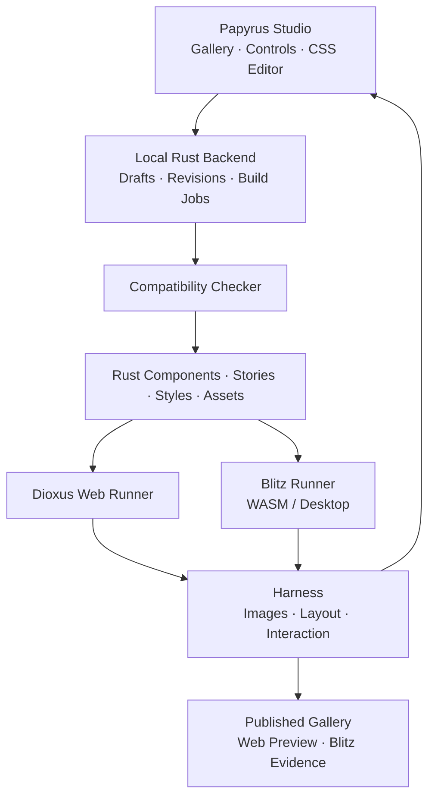

**Papyrus ควรเป็นเครื่องมือออกแบบ ตรวจสอบ และเผยแพร่คอมโพเนนต์ Rust ที่ใช้ stylesheet ร่วมกันระหว่าง Web และ Blitz โดยมีหน้าดูคอมโพเนนต์แบบ Storybook และวงจรแก้ไข → ตรวจสอบ → build/reload → preview อยู่ในระบบเดียว**

จุดขายคือ **การนำดีไซน์จากเว็บมาใช้ใน Dioxus Native พร้อมหลักฐานว่ารูปลักษณ์และพฤติกรรมผ่านการตรวจบน renderer ที่ระบุไว้** ผู้พัฒนาจึงไม่ต้องรอจนประกอบเป็นแอป Desktop เต็มตัวจึงจะพบปัญหา

ในแผนนี้ใช้ชื่อ **Web CSS** และ **Blitz CSS** ตามที่ตกลงกัน ทั้งสองชื่อหมายถึง CSS ที่ใช้กับ renderer แต่ละฝั่ง ไม่ได้หมายถึงการสร้างภาษา CSS ใหม่ ส่วนรายละเอียดด้านล่างเป็นข้อเสนอการออกแบบ Papyrus ซึ่งยังต้องพิสูจน์ด้วยต้นแบบก่อนเลือกสถาปัตยกรรมถาวร

**1. ปัญหาที่ Papyrus จะเข้าไปแก้**

การออกแบบคอมโพเนนต์บนเว็บทำได้สะดวก แต่เมื่อย้ายมาใช้กับ renderer อีกตัว ความถูกต้องของ CSS syntax ไม่ได้ยืนยันว่ารองรับทุกความสามารถ หรือแสดงผลเหมือนเดิม

ตัวอย่างเช่น สถานะปัจจุบันของ Blitz ระบุว่ารองรับ Grid แต่ยังไม่รองรับ subgrid และความสามารถบางอย่าง เช่น `backdrop-filter` ขึ้นกับ rendering backend ที่เลือก ดังนั้นคำว่า “รองรับ Blitz” ต้องมีข้อมูลเวอร์ชันและ backend ประกอบด้วย [Blitz CSS support](https://blitz.is/status/css)

ปัญหาที่ต้องจัดการมีสี่ส่วน:

- **ความเข้ากันได้ของ stylesheet:** ใช้ declaration, value, selector หรือกฎที่อีกฝั่งไม่รองรับ
- **ความต่างในการแสดงผล:** ข้อความตัดบรรทัดต่างกัน ขนาดผิด หรือเนื้อหาถูกตัด
- **ความต่างในการใช้งาน:** หน้าตาถูกต้อง แต่ focus, keyboard หรือ input ทำงานต่างกัน
- **วงจรทำงานที่กระจัดกระจาย:** แก้ CSS ใน editor เปิดเว็บ เปิด Native แล้วตรวจและบันทึกผลเอง

Papyrus จะเชื่อมสี่ส่วนนี้เข้าด้วยกัน โดยมี component และ story ชุดเดียวเป็นฐานในการทดสอบ

**2. สิ่งที่ผู้ใช้จะได้จาก Papyrus**

| ผู้ใช้ | งานที่ทำผ่าน Papyrus | ผลที่ได้รับ |
|---|---|---|
| Designer | นำเข้า HTML/CSS ปรับสี ระยะ ฟอนต์ และดูสอง renderer | เห็นข้อจำกัดระหว่างออกแบบ |
| Rust developer | ผูก story เข้ากับ Dioxus component จริง | พัฒนาและตรวจคอมโพเนนต์แยกจากแอปหลัก |
| ทีม Design System | จัดการ theme, tokens, variants และสถานะ | มีชุดคอมโพเนนต์พร้อมขอบเขตการรองรับ |
| QA | รัน stories และ interaction ชุดเดียวบนสองฝั่ง | มีผลทดสอบที่ทำซ้ำและตรวจย้อนกลับได้ |
| ผู้ดูออนไลน์ | เปิด gallery ทดลอง Web component และดูผล Blitz | ประเมินคอมโพเนนต์ได้โดยไม่ต้องติดตั้ง Rust |
| ผู้ดูแล Blitz/Dioxus | รับกรณีทดสอบขนาดเล็กจากปัญหาที่พบ | ทำซ้ำและวิเคราะห์ renderer regression ได้ง่ายขึ้น |

ผลส่งออกหลักควรมี **คอมโพเนนต์และ stylesheet, gallery ออนไลน์ และรายงานการรองรับ** ซึ่งอ้างถึง source revision เดียวกัน

**3. ประสบการณ์ใช้งานหลัก**

หน้าทำงานของ Papyrus ควรแบ่งเป็นพื้นที่ที่สัมพันธ์กัน:

| พื้นที่ | หน้าที่ |
|---|---|
| Component browser | เลือก component, variant และ story |
| Preview | แสดง Web และ Blitz คู่กัน พร้อมขนาด viewport และ theme |
| Controls | เปลี่ยน props และข้อมูลตัวอย่าง |
| Style editor | แก้ CSS และ design tokens |
| Diagnostics | แสดงปัญหา ตำแหน่ง source และ target ที่ได้รับผลกระทบ |
| Comparison | ดูภาพซ้อน ภาพแตกต่าง และผลทดสอบ |
| Build status | แสดง revision ที่แต่ละ preview โหลดอยู่ และสถานะ build |

ตัวอย่างการใช้งาน:

1. เปิด story ของ Card
2. นำเข้า stylesheet ที่ออกแบบบนเว็บ
3. Web preview แสดงดีไซน์ต้นฉบับ
4. Papyrus รายงานว่ามี declaration ที่ไม่อยู่ในขอบเขตของ Blitz target
5. ผู้ใช้เลือกปรับดีไซน์หรือเพิ่ม style เฉพาะ target
6. ระบบแสดง diff ก่อนนำการปรับไปใช้
7. Preview ทั้งสองฝั่งโหลด stylesheet revision ใหม่
8. รันการตรวจ แล้วบันทึกผลพร้อม revision

ควรแยก **การทดลองดู** กับ **สถานะผ่านการตรวจ** ให้ชัดเจน ผู้ใช้ทดลอง style ที่ยังไม่ผ่านได้ แต่ระบบต้องไม่ติดป้ายว่ารองรับสองฝั่งจนกว่าจะมีหลักฐานครบ

**4. กำหนดขอบเขตด้วย Compatibility Profile**

Papyrus ต้องมีข้อมูลกลางที่บอกว่า target ชุดนี้รองรับอะไร เรียกว่า Compatibility Profile

Profile หนึ่งชุดควรระบุ:

- เวอร์ชัน Dioxus และ Blitz รวมถึง commit หากใช้จาก Git
- Rendering backend ของ Blitz
- Browser และเวอร์ชันที่ใช้ตรวจ
- OS, scale factor และฟอนต์ที่ใช้
- ขอบเขต CSS, HTML และ interaction
- หลักฐานจากเอกสารหรือกรณีทดสอบ
- ข้อยกเว้นและข้อจำกัดที่ทราบ

สถานะของแต่ละความสามารถควรแยกเป็น:

| สถานะ | ความหมาย |
|---|---|
| Supported | ผ่านในเงื่อนไขและเวอร์ชันที่ระบุ |
| Conditional | ผ่านเมื่อใช้ backend หรือเงื่อนไขเฉพาะ |
| Unsupported | target นี้ไม่รองรับ |
| Unknown | ยังไม่มีหลักฐานเพียงพอ |
| Regression | เคยผ่าน แต่ไม่ผ่านหลังเปลี่ยนเวอร์ชันหรือ implementation |

**Unknown ต้องไม่ถูกนับเป็น Supported**

ขอบเขตนี้ต้องตรวจละเอียดถึงค่า เช่น การอนุญาต `transform` ไม่ได้แปลว่าอนุญาตทั้ง 2D และ 3D และการตรวจ `var()` ต้องพิจารณาค่าที่ถูกนำมาแทนด้วย

ผมเสนอวิธีจัด stylesheet สองแบบ:

- **Shared:** ใช้ stylesheet เดียวภายในขอบเขตที่ผ่านทั้งสอง target
- **Shared พร้อม target overrides:** ใช้ฐานเดียวกัน แล้วมีส่วนเฉพาะ Web หรือ Blitz ที่ระบุอย่างชัดเจน

วิธีที่สองช่วยรักษาดีไซน์เดิมเมื่อความสามารถบางส่วนยังใช้ร่วมกันไม่ได้ โดย Papyrus แสดงต้นทุนของความต่างให้เห็น ไม่สร้าง stylesheet สองชุดที่แยกพัฒนาจนหลุดจากกัน

**5. Harness ต้องตรวจสามชั้น**

**ชั้นแรก — ตรวจ source และ CSS ที่ใช้งานจริง**

ใช้ CSS parser อ่านโครงสร้าง stylesheet แทนการตรวจด้วย regex แล้วตรวจ declaration, value, selector, pseudo-class, pseudo-element และ at-rule ตาม profile

ต้องครอบคลุม CSS จาก stylesheet, `@import`, inline style และ CSS ที่เครื่องมืออย่าง Tailwind สร้างออกมา โดยตรวจ output หลังการแปลงอีกครั้งด้วย

[Lightning CSS](https://lightningcss.dev/) เป็นตัวเลือกที่ควรทดลอง เพราะมี parser, transformer และ bundler ที่เขียนด้วย Rust แต่ browser targets ของมันไม่ได้เป็นฐานข้อมูลความสามารถของ Blitz โดยอัตโนมัติ Papyrus ยังต้องมีกฎของตัวเอง

สำหรับ style ที่สร้างจาก Rust แบบ dynamic ตัวตรวจ source อาจวิเคราะห์ได้ไม่ครบ ต้องรายงานส่วนที่ตรวจไม่ได้ และตรวจค่าที่ปรากฏจริงใน stories เพิ่มเติม ไม่ควรอ้างว่าการรัน stories ครอบคลุมทุก branch ของโปรแกรม

ผลตรวจแต่ละรายการควรมี:

- ไฟล์ บรรทัด และตำแหน่ง
- expression หรือ declaration ที่มีปัญหา
- target/profile ที่ได้รับผลกระทบ
- เหตุผลและแหล่งหลักฐาน
- story ที่พบปัญหา หากมี
- แนวทางปรับ พร้อมระบุว่ารักษาความหมายเดิมได้หรือไม่

**ชั้นที่สอง — ตรวจ layout และภาพ**

รัน story เดียวกันด้วย props, theme, assets, ฟอนต์ และขนาดพื้นที่เดียวกัน แล้วเก็บภาพพร้อมข้อมูล layout เท่าที่ runner เข้าถึงได้

การเปรียบเทียบควรมีสองประเภท:

| การเปรียบเทียบ | จุดประสงค์ |
|---|---|
| Web ใหม่กับ Web baseline และ Blitz ใหม่กับ Blitz baseline | ตรวจ regression ภายใน renderer เดิม |
| Web กับ Blitz ของ revision เดียวกัน | ตรวจความต่างระหว่าง renderer |

ความต่างระหว่าง renderer อาจเป็นความต่างที่ยอมรับได้ จึงไม่ควร fail จากทุก pixel ที่ต่างกัน โดยเฉพาะการวาดฟอนต์ แต่ควรตรวจเงื่อนไขสำคัญ เช่น เนื้อหาไม่ถูกตัด ขนาดอยู่ในช่วงที่กำหนด และองค์ประกอบสำคัญไม่ทับกัน

ต้องควบคุม animation, เวลา และข้อมูลสุ่มก่อนถ่ายภาพ ส่วน baseline ที่เปลี่ยนต้องมีขั้นตอน review เพื่อไม่ให้การอัปเดตภาพอ้างอิงกลบ regression

ฝั่งเว็บสามารถใช้ [Playwright visual comparisons](https://playwright.dev/docs/test-snapshots) ได้ ส่วนการ capture และอ่าน layout จาก Blitz ต้องพิสูจน์กับเวอร์ชันที่เลือกในระยะต้นแบบ

**ชั้นที่สาม — ตรวจ interaction และ accessibility**

ทดสอบ action เดียวกันบน component จริง เช่น:

- Tab เข้าและออกจาก control
- กด Enter หรือ Space
- พิมพ์และแก้ข้อความ
- เปลี่ยนค่าและตรวจ state
- เปิด/ปิด dialog และตรวจ focus
- ตรวจ disabled และ error state

การกำหนดค่าให้ component ดูเหมือนถูกคลิก ยังไม่ใช่การทดสอบเส้นทาง input จริง ต้องแยกสองอย่างนี้ในรายงาน

สำหรับภาษาไทย ควรมีกรณีทดสอบการตัดบรรทัด การเลือกข้อความ และการป้อนข้อความผ่าน IME ตั้งแต่ต้น เพราะสถานะ event support ของ Blitz ยังระบุข้อจำกัดบางส่วนเกี่ยวกับ composition และ clipboard [Blitz event support](https://blitz.is/status/events)

**6. Story ของ Papyrus ต้องใช้คอมโพเนนต์จริง**

แต่ละ story ควรประกอบด้วย:

| ข้อมูล | ตัวอย่าง |
|---|---|
| Component และ variant | Button / Primary |
| Props | ข้อความ ขนาด disabled |
| State | Default, focus, loading, error |
| Environment | Theme, viewport, font |
| Actions | คลิก กดคีย์ พิมพ์ |
| Assertions | callback ถูกเรียก เนื้อหาไม่ล้น |
| Target results | Web, Blitz WASM, Blitz Desktop |
| Revision | source, stylesheet และ profile ที่ใช้ |

เริ่มต้นด้วยการลงทะเบียน story และ controls แบบ explicit ก่อน จะตรวจสอบง่ายกว่าการสร้าง macro เพื่อค้นหาและอนุมาน props ทุกชนิดตั้งแต่รุ่นแรก

Story factory ควรอยู่ใน Rust และถูกเรียกใช้จากทั้ง Web runner และ Dioxus Native runner ส่วน controls รับส่งเฉพาะข้อมูล props ที่ประกาศไว้ ไม่พยายาม serialize Rust closure หรือ arbitrary Rust value

**7. การนำเข้า Web CSS และปรับไปใช้กับ Blitz**

ควรแยกการนำเข้าเป็นสามกรณี:

| สิ่งที่นำเข้า | สิ่งที่ Papyrus ช่วยทำ |
|---|---|
| CSS และ assets | ตรวจความเข้ากันได้ จัด dependency และดูผลบนสอง renderer |
| HTML + CSS | สร้าง visual reference และช่วยแปลง markup ไปเป็น RSX |
| Component ที่พึ่ง JavaScript framework | แยก markup/style ออกจาก behavior และระบุงานที่ต้องเขียนใน Rust |

การแปลง HTML เป็น RSX ช่วยเรื่องโครงสร้าง แต่ไม่ได้แปลง behavior ของ React หรือ JavaScript ให้เป็น Rust โดยอัตโนมัติ Dioxus มีเครื่องมือแปล HTML เป็น RSX อยู่แล้ว จึงควรประเมินการใช้ต่อ [Dioxus project structure](https://dioxuslabs.com/learn/0.7/beyond/project_structure/)

ผมเสนอให้ importer ทำงานตามลำดับ:

1. เก็บต้นฉบับไว้โดยไม่แก้ไข
2. สำรวจ stylesheet, imports, assets และฟอนต์
3. สร้างรายงานตาม compatibility profile
4. เสนอการปรับที่ทำได้ โดยรักษา cascade และ specificity
5. แสดง diff และ preview ก่อน/หลัง
6. รันทดสอบกับ story ที่เกี่ยวข้อง
7. ส่งออก source ที่ปรับแล้ว พร้อมสิ่งที่ยังต้องแก้ด้วยมือ

การปรับ syntax ที่เทียบเท่ากันกับการเปลี่ยนดีไซน์ต้องแยกกัน เช่น การแทน blur ด้วยสีพื้นเป็นการเปลี่ยนดีไซน์ ระบบจึงไม่ควรทำเงียบ ๆ

**8. สถาปัตยกรรมที่เสนอ**

แนะนำเริ่มเป็นเครื่องมือที่ทำงานกับ repository บนเครื่องผู้พัฒนา แล้วส่ง gallery ออกไปเผยแพร่ได้

แบ่งหน้าที่หลักเป็นสี่ส่วนก็เพียงพอในช่วงแรก:

| ส่วน | ความรับผิดชอบ |
|---|---|
| Papyrus Core | Profile, diagnostics, story metadata และผลตรวจ |
| Papyrus Studio | หน้าดู component, controls, editor และ comparison |
| Papyrus Backend/CLI | จัดการไฟล์ revision และ build/run jobs |
| Papyrus Harness | รัน target เก็บผล และตรวจ assertions |

ยังไม่จำเป็นต้องแยกเป็น microservices

ข้อเสนอเทคโนโลยีคือ Dioxus สำหรับ Studio, Rust backend สำหรับ orchestration, CSS parser ที่มีอยู่สำหรับ stylesheet และ Playwright สำหรับ browser runner ส่วน native runner ใช้ Dioxus Native/Blitz โดยตรง การเลือก dependency และ API integration ขั้นสุดท้ายให้ตัดสินจากต้นแบบ

**9. Backend และวงจรแก้ไข → compile/reload**

ไม่ควร compile Rust ใหม่ทุกครั้งที่เปลี่ยนสีหรือ spacing เพราะ Dioxus มี asset hot reload สำหรับ CSS และ RSX hot reload อยู่แล้ว ส่วน Rust hot patching เป็นความสามารถที่ยังมีข้อจำกัด โดยเฉพาะการแก้ dependency crate ใน workspace [Dioxus hot reload](https://dioxuslabs.com/learn/0.7/essentials/ui/hotreload/)

Papyrus ควรเลือกเส้นทางตามชนิดการเปลี่ยน:

| การเปลี่ยน | เส้นทางที่เสนอ |
|---|---|
| เปลี่ยน props ใน controls | อัปเดต state ของ preview |
| เปลี่ยน CSS/tokens | ตรวจ CSS แล้ว reload stylesheet |
| เปลี่ยน source ของ Tailwind/SCSS | สร้าง CSS output ตรวจ แล้ว reload |
| เปลี่ยน RSX | ใช้ hot reload หาก target รองรับ |
| เปลี่ยน Rust logic หรือ component signature | rebuild/restart เป็นเส้นทางพื้นฐาน |
| ใช้ Rust hot patching | เปิดเมื่อทดสอบกับ project และ target แล้ว |

วงจร backend ควรทำดังนี้:

1. รับ draft พร้อม revision ที่ผู้ใช้กำลังแก้
2. ตรวจ conflict หากไฟล์เปลี่ยนจาก editor หรือ process อื่น
3. ตรวจ syntax และ compatibility
4. สร้าง stylesheet/build output ในพื้นที่ทดลอง
5. ส่ง revision ใหม่ให้ runner ที่เกี่ยวข้อง
6. รอ runner ยืนยันว่าโหลด revision นั้นแล้ว
7. รันการตรวจที่จำเป็น
8. แสดงผลและให้บันทึกกลับ source ของ project

หาก build ล้มเหลว ให้คง preview ล่าสุดที่ทำงานได้ พร้อมระบุว่าเป็น revision เก่า ส่วน draft ต้องยังอยู่เพื่อแก้ไขต่อ

หาก Web โหลด revision ใหม่แล้วแต่ Blitz ยังไม่เสร็จ ต้องแสดงว่า **กำลังรอผล** และไม่เปรียบเทียบสองภาพราวกับเป็น source รุ่นเดียวกัน งาน build เก่าที่เสร็จช้าต้องไม่ทับผลจาก revision ใหม่

CSS reload ของ Blitz ต้องทดลองจริงก่อน หากยังใช้เส้นทาง reload ที่ต้องการไม่ได้ ให้ runner restart โดยอัตโนมัติ พร้อมเปิด story เดิมกลับมา เส้นทางนี้ยังตอบโจทย์การแก้ไขแล้วเห็นผล แม้อาจรักษา state ได้ไม่ทั้งหมด

Backend รุ่นแรกควรเขียนได้เฉพาะ project ที่เปิดอยู่ และไฟล์ที่กำหนดไว้ การ compile/run ใช้ source จาก project ที่ผู้ใช้เลือก ส่วนการนำเข้า CSS หรือ HTML ต้องไม่ทำให้ script หรือ Rust code จากแหล่งภายนอกถูกเรียกใช้อัตโนมัติ

**10. การเผยแพร่ออนไลน์และ Blitz preview**

มีข้อมูลที่ทำให้เป้าหมายนี้เป็นไปได้มากขึ้น: repository ของ Blitz มีตัวอย่างที่รันบน WASM ใน browser รวมทั้งตัวอย่างที่ใช้ Dioxus อย่าง TodoMVC และ 7GUIs เอกสารระบุ backend และการ bundle ฟอนต์สำหรับเส้นทางนี้ไว้แล้ว [Blitz WASM examples](https://github.com/DioxusLabs/blitz/blob/main/HOWTO_WASM.md)

จึงควรออกแบบผลเผยแพร่สามระดับ:

| รูปแบบ | ผู้ชมใช้งานได้อย่างไร | หลักฐานที่ได้ |
|---|---|---|
| Web gallery | ทดลอง Dioxus Web component | ผลบน browser DOM |
| Web + Blitz WASM gallery | ทดลองสอง renderer คู่กันใน browser | ผล Blitz บน WASM/backend ที่ระบุ |
| Gallery พร้อม Desktop report | ดูภาพและผลจาก native runner | ผลบน Desktop environment ที่ระบุ |

**Blitz WASM ผ่าน ไม่ได้แปลว่า Blitz Desktop ผ่านแล้ว** เพราะ backend, ฟอนต์ และการเชื่อมกับระบบ input อาจต่างกัน ผลทั้งสองต้องเก็บแยก target

เว็บไซต์ที่เผยแพร่แบบ static สามารถแสดง component และรายงานได้ แต่การแก้ source แล้ว compile Rust ต้องเชื่อมกับ local backend หรือ hosted build backend เพิ่มเติม

แนะนำให้ MVP ใช้ local backend สำหรับแก้ไข และ static gallery สำหรับเผยแพร่ก่อน ระบบ hosted editing/build ค่อยเพิ่มเมื่อวงจร local เชื่อถือได้แล้ว

**11. Papyrus ต่างจากเครื่องมือที่มีอย่างไร**

Papyrus ควรมีข้อได้เปรียบในงานเฉพาะนี้ โดยใช้ความสามารถที่มีอยู่ต่อให้มากที่สุด

| แนวทางที่มีอยู่ | สิ่งที่ทำได้ดี | สิ่งที่ Papyrus เสนอเพิ่ม |
|---|---|---|
| Storybook | Component development, docs, interaction, visual และ accessibility testing | Profile และ workflow ตรวจ Web CSS กับ Blitz CSS บน Rust component เดียวกัน |
| Dioxus Showcase | Gallery สำหรับ Dioxus และ static export | Import/adaptation, สอง renderer, compatibility harness และวงจรแก้ stylesheet |
| CSS linting เช่น Stylelint | กฎตรวจ source และ plugin | กฎที่ผูกกับ Blitz version/backend และหลักฐาน runtime |
| Browser visual testing | ตรวจภาพและ interaction บนเว็บ | เชื่อมผลจาก Blitz และ Desktop Native |
| เปิด Web/Native แล้วตรวจเอง | เริ่มได้ง่ายและไม่ต้องสร้าง tooling | ขั้นตอนที่ทำซ้ำได้ พร้อม revision และรายงาน |

Storybook มีระบบทดสอบที่กว้างอยู่แล้ว และ Stylelint รองรับ custom plugins จึงไม่ควรอ้างว่าเครื่องมือเหล่านี้ทำงานลักษณะนี้ไม่ได้เลย ประเด็นคือ Papyrus ทำให้กระบวนการเฉพาะ Dioxus/Blitz เป็น workflow ที่พร้อมใช้ [Storybook testing](https://storybook.js.org/docs/writing-tests), [Stylelint plugins](https://stylelint.io/developer-guide/plugins/)

Dioxus Showcase มี gallery และ static export อยู่แล้ว แต่ยังระบุสถานะ alpha จึงควรทดลองการใช้ต่อก่อนตัดสินใจว่าจะนำบางส่วนมาใช้หรือสร้าง shell ของ Papyrus เอง [Dioxus Showcase](https://github.com/Dodecahedr0x/dioxus-showcase)

สิ่งที่ควรเป็นความสามารถหลักของ Papyrus คือ **ฐานข้อมูลความเข้ากันได้ที่มีหลักฐาน, harness ระหว่าง renderer และ workflow ปรับดีไซน์จากเว็บ** ส่วน gallery และ build tools เป็นส่วนที่ควรใช้ของเดิมได้มากที่สุด

**12. แผนพัฒนาและเกณฑ์ผ่านแต่ละระยะ**

| ระยะ | งาน | เกณฑ์ผ่าน |
|---|---|---|
| **0 — พิสูจน์เส้นทางเทคนิค** | เลือกเวอร์ชัน ทดลอง Button, Card, TextInput บน Web, Blitz WASM และ Desktop ตรวจ reload/capture/input | story เดียวรันได้ครบ และอธิบายข้อจำกัดแต่ละ target ได้ |
| **1 — Compatibility harness** | Parser, profile ชุดแรก, diagnostics, fixtures, ภาพและผลตรวจ | ตรวจพบทั้ง property ที่ไม่รองรับและ value ที่เกินขอบเขต; Unknown ไม่ผ่านเงียบ ๆ |
| **2 — Papyrus MVP** | Gallery, controls, CSS editor, local backend, reload/rebuild, comparison, static export | แก้ CSS ใน Studio แล้วเห็นผลสองฝั่ง พร้อม revision และผลตรวจ |
| **3 — Web import/adaptation** | Import HTML/CSS/assets, markup conversion, suggestions, diff และ target overrides | เก็บต้นฉบับครบ และระบุส่วนที่แปลงไม่ได้ |
| **4 — Team workflow** | CI, baseline review, gallery ต่อ revision, hosted backend | ตรวจซ้ำใน environment ที่กำหนดได้ และ review การเปลี่ยนดีไซน์ได้ |
| **5 — ขยาย target** | เพิ่ม renderer/framework ตามโครงการจริง | adapter ใหม่ใช้ stories/report ร่วมได้ โดยระบุขอบเขตของตัวเอง |

ระยะ 0 ต้องตอบคำถามที่มีผลต่อสถาปัตยกรรมก่อน:

- Blitz WASM เหมาะกับการฝัง preview คู่กันใน Studio หรือไม่
- เปลี่ยน stylesheet ของ Blitz อย่างไรให้เชื่อถือได้
- เก็บภาพและข้อมูล layout ผ่าน API ที่มีได้เพียงใด
- ส่ง input และตรวจ focus บน native runner ได้อย่างไร
- Thai text และ IME มีข้อจำกัดอะไรใน target ที่เลือก
- การแยก component crate กับ preview crate กระทบ reload อย่างไร

MVP ควรมี Button, Card และ TextInput ให้ครบทั้งวงจรก่อน แล้วเพิ่ม Tabs, Dialog และ Select เพื่อทดสอบ interaction ที่ซับซ้อนขึ้น โดยไม่ข้ามข้อจำกัดที่พบ

**13. ประโยชน์ต่อ Dioxus, Blitz และ Rust ecosystem**

สำหรับ **Dioxus** Papyrus จะช่วยให้ component library ถูกพัฒนา ตรวจ และเผยแพร่แยกจาก application ได้ Designer และ developer ใช้ component เดียวกันในการสนทนา และการแก้ theme มีเส้นทางตรวจผลก่อนนำไปใช้ในแอป

สำหรับ **Blitz** Papyrus จะเปลี่ยนข้อจำกัดที่พบในงานออกแบบจริงให้เป็นกรณีทดสอบเล็ก ๆ ที่ทำซ้ำได้ เมื่อ renderer รุ่นใหม่ออกมา ก็รันชุดเดิมเพื่อดูว่าความสามารถใดดีขึ้นหรือเกิด regression โดยไม่ปรับ profile เป็น “ผ่าน” เพียงเพราะอัปเดต dependency

สำหรับ **Rust Desktop/Web projects** จะช่วยให้แชร์รูปลักษณ์และ story ของ component ได้ พร้อมแยก platform services ออกจากตัว component ที่นำไปแสดงใน gallery

สำหรับ framework อื่นในอนาคต ควรขยายผ่าน runner และรูปแบบรายงานกลาง แต่ต้องรักษาข้อเท็จจริงว่า framework ที่ไม่ใช้ CSS อาจแชร์ได้เฉพาะ tokens, stories และ design intent แล้วต้องมีการแปลง style เพิ่มเติม ไม่ควรสัญญาว่า stylesheet เดียวใช้กับ Rust GUI ทุกตัวได้ทันที

**14. วิธีวัดว่าโครงการนี้ให้ประโยชน์จริง**

ควรเก็บข้อมูลจากการใช้งานต้นแบบก่อนตั้งเป้าตัวเลข:

| สิ่งที่วัด | บอกประโยชน์อะไร |
|---|---|
| เวลาตั้งแต่แก้ CSS จน preview โหลด revision ใหม่ | ความคล่องตัวของวงจรออกแบบ |
| ปัญหาที่ harness พบก่อนรวมเข้าแอป | การลดงานแก้ย้อนหลัง |
| ปัญหาที่หลุดไปพบภายหลัง | ความครบถ้วนของการตรวจ |
| จำนวน target overrides ต่อ component | ต้นทุนในการใช้ดีไซน์ร่วม |
| ความถี่ที่ต้อง rebuild/restart | ข้อจำกัดของ reload |
| ความเสถียรของภาพและผลทดสอบเมื่อรันซ้ำ | ความน่าเชื่อถือของ CI |
| งานปรับด้วยมือหลัง import | ประสิทธิผลของ importer |

ข้อเสนอสำหรับ pitch คือ:

> **Papyrus ช่วยทีมสร้าง Design System สำหรับ Rust จากแนวทาง HTML/CSS ที่คุ้นเคย นำ component จริงมาออกแบบและทดลองผ่านเว็บ ตรวจความเข้ากันได้กับ Blitz และแก้ stylesheet พร้อม build/reload ในหน้าทำงานเดียว ผลลัพธ์คือชุด component ที่เผยแพร่ได้ พร้อมหลักฐานการรองรับ Desktop และ Web ของแต่ละ revision**

ยังไม่ได้สร้างต้นแบบหรือ benchmark; แผนนี้เว้นระบบ plugin และการแปลง JavaScript behavior อัตโนมัติไว้ภายหลัง  
ความเสี่ยงหลักที่ต้องพิสูจน์ก่อนลงทุนเต็มรูปแบบคือ Blitz reload/capture/input และความต่างระหว่าง Blitz WASM กับ Desktop backend.